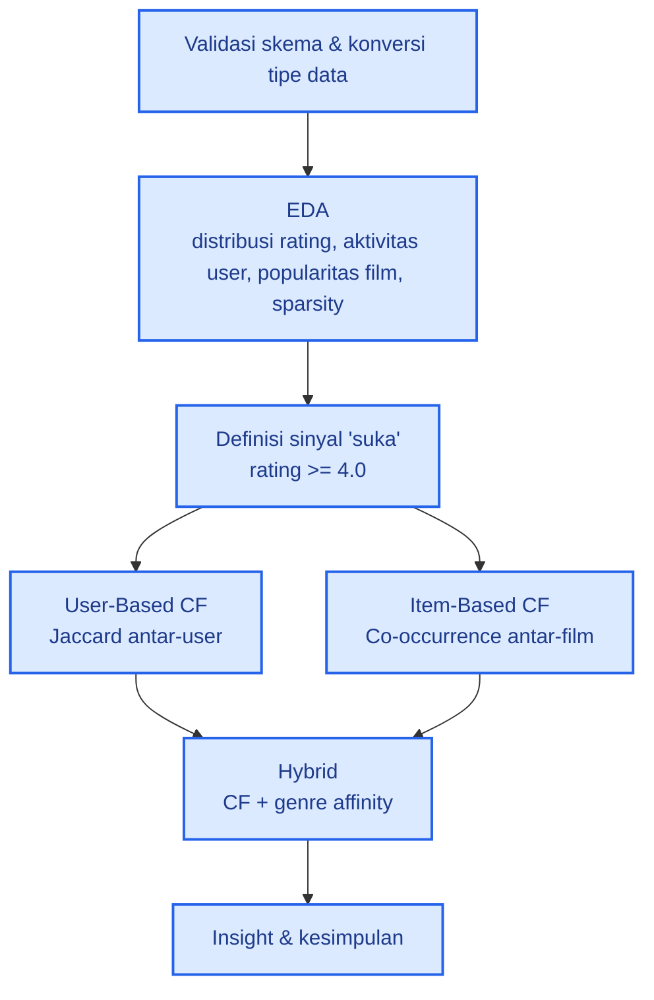

# 🎬 Sistem Rekomendasi Film dengan Neo4j: Collaborative Filtering & Hybrid

Project analisis dan sistem rekomendasi film berbasis **graph database Neo4j**. Tiga pendekatan dibandingkan: **User-Based CF (Jaccard)**, **Item-Based CF (co-occurrence)**, dan **Hybrid (Genre + User CF)**.

## 1. Tujuan
- Memahami karakteristik data rating (distribusi, aktivitas user, sparsity).
- Merekomendasikan film yang belum ditonton berdasarkan kemiripan selera antar-user.
- Merekomendasikan film berdasarkan pola co-occurrence antar-film.
- Menggabungkan preferensi genre dan sinyal user serupa dalam satu skor hybrid.

## 2. Dataset & Skema Graph

| Komponen | Detail |
|---|---|
| Node | `User` (610), `Movie` (9.742), `Genre` (20) |
| Relationship | `RATED` (100.836), `HAS` (22.084) |
| Property | `userId`, `movieId`, `title`, `genre`/`name`, `rating`, `timestamp` |

```
(:User)-[:RATED {rating, timestamp}]->(:Movie)-[:HAS]->(:Genre)
```

- Label `Person` tidak memiliki node pada data ini, sehingga tidak dipakai.
- Property `rating` dan `timestamp` awalnya bertipe STRING dan dikonversi menjadi angka sebelum analisis.
- Definisi "suka": **rating ≥ 4.0**. Target uji: **user 414** (user paling aktif) dan film acuan **Forrest Gump (1994)**.

## 3. Alur Penelitian



## 4. Hasil & Insight

### a. Exploratory Data Analysis
- **Rating condong positif:** rata-rata 3,50 (median 3,5), modus 4.0 (26,6%). Rating ≥ 4.0 mencakup **48,2%** data, sehingga ambang "suka" ≥ 4.0 selektif namun tetap menghasilkan himpunan yang cukup besar.
- **Aktivitas user timpang:** 10 user teratas (1,6% dari user) menyumbang ±16% dari seluruh rating. User paling aktif cenderung lebih kritis (rata-rata rating turun dari 3,71 pada user 20–99 rating menjadi 3,35 pada user 500+ rating).
- **Popularitas ≠ kualitas:** *Shawshank Redemption* populer sekaligus berating tertinggi (4,43), sedangkan *Jurassic Park* sangat populer tetapi hanya 3,75.
- **Data sangat sparse (98,3%):** rata-rata satu film hanya dinilai ±10 user, sehingga kemiripan antar-user perlu ambang irisan minimal.

### b. User-Based CF (Jaccard): user 414
User 414 menyukai 1.227 film. Tetangga terdekat: user 474 (Jaccard 0,195, irisan 329 film).

| # | Rekomendasi | Skor CF | Pendukung |
|---|---|---|---|
| 1 | Psycho (1960) | 2,67 | 19 |
| 2 | The Shining (1980) | 2,32 | 16 |
| 3 | Annie Hall (1977) | 1,83 | 13 |
| 4 | 12 Angry Men (1957) | 1,78 | 12 |
| 5 | From Dusk Till Dawn (1996) | 1,67 | 11 |

**Insight:** nilai Jaccard maksimum hanya ±0,20 (wajar pada data sparse), jadi yang dibaca adalah peringkat relatifnya. **7 dari 20 tetangga teratas termasuk 10 user paling aktif**, menandakan bias *heavy user*.

### c. Item-Based CF (Co-occurrence)
Film yang sering disukai bersama **Forrest Gump**:

| # | Film | Disukai bersama | Confidence |
|---|---|---|---|
| 1 | Shawshank Redemption (1994) | 168 | 0,675 |
| 2 | Pulp Fiction (1994) | 136 | 0,546 |
| 3 | Silence of the Lambs (1991) | 128 | 0,514 |
| 4 | Braveheart (1995) | 109 | 0,438 |
| 5 | The Matrix (1999) | 122 | 0,490 |

Rekomendasi personal untuk **user 414** (skor dinormalisasi popularitas):

| # | Rekomendasi | Skor | Film pemicu (dari 20) |
|---|---|---|---|
| 1 | The Shining (1980) | 47,9 | 19 |
| 2 | Psycho (1960) | 42,1 | 20 |
| 3 | Life Is Beautiful (1997) | 37,3 | 16 |
| 4 | From Dusk Till Dawn (1996) | 36,6 | 20 |
| 5 | 12 Angry Men (1957) | 35,4 | 19 |

**Insight:** 7 dari 10 film terkait Forrest Gump ada di daftar film paling banyak di-review, sehingga co-occurrence murni condong ke film populer. Normalisasi popularitas mengangkat film yang lebih niche, dan tiap rekomendasi didukung banyak film favorit user, bukan hanya satu.

### d. Hybrid (Genre + User CF)
Skor hybrid = 0,6 × CF ternormalisasi + 0,4 × genre affinity.

| # | Rekomendasi | CF | Genre | Hybrid |
|---|---|---|---|---|
| 1 | Psycho (1960) | 1,000 | 0,075 | 0,630 |
| 2 | The Shining (1980) | 0,872 | 0,013 | 0,528 |
| 3 | Life Is Beautiful (1997) | 0,550 | 0,474 | 0,520 |
| 4 | For a Few Dollars More (1965) | 0,587 | 0,399 | 0,512 |
| 5 | From Dusk Till Dawn (1996) | 0,626 | 0,321 | 0,504 |

**Insight:** genre favorit user 414 didominasi Drama, sedangkan Horror sangat kecil (±1,3%), tetapi Psycho dan The Shining tetap teratas karena sinyal CF kuat. Hybrid menaikkan film yang cocok genre (*Life Is Beautiful* dari peringkat 9 di User-CF ke peringkat 3) dan menyingkirkan film yang hanya kuat di CF (Borat, Harry Potter PoA, The Birds).

### e. Perbandingan Pendekatan

| Aspek | User-CF | Item-CF | Hybrid |
|---|---|---|---|
| Dasar | Kemiripan antar-user | Pola co-occurrence antar-film | CF + kecocokan genre |
| Kelebihan | Personal, menangkap selera kelompok | Stabil, mudah dijelaskan | Lebih relevan secara genre dan beragam |
| Kelemahan | Bias *heavy user* | Bias popularitas tanpa normalisasi | Condong ke film multi-genre |

## 5. Kesimpulan
1. Data sangat sparse (98,3%) dan timpang, sehingga ambang irisan dan jumlah pendukung diperlukan agar rekomendasi tidak noise.
2. **7 dari 10 rekomendasi User-CF dan Item-CF sama** untuk user 414, yang menjadi indikasi bahwa rekomendasi tersebut kuat.
3. Hybrid menjaga dua rekomendasi teratas tetapi menyesuaikan urutan berdasarkan genre, sehingga hasil lebih sesuai profil user.
4. Pendekatan graph memudahkan CF karena cukup menelusuri pola `User → Movie ← User` tanpa membangun matriks eksplisit.
